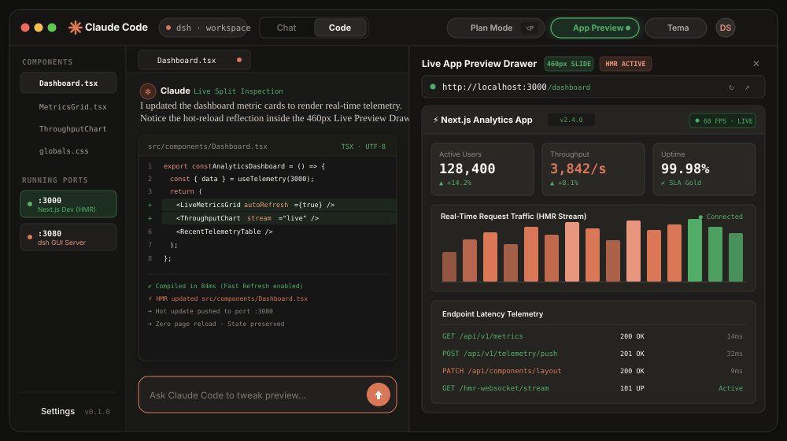
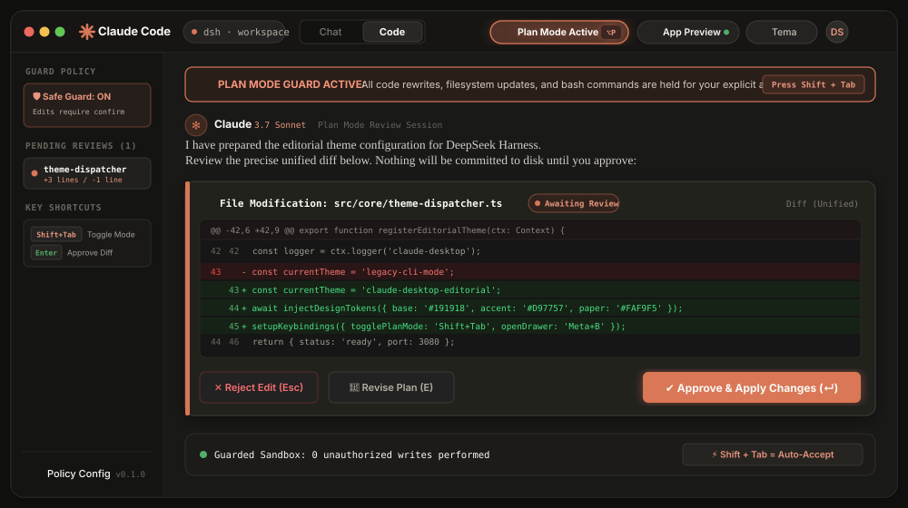

# Claude Code Desktop GUI para DeepSeek Harness

Transforma la interfaz de DeepSeek Harness (`dsh`) en el entorno gráfico de escritorio de **Claude Code Desktop**: estética cálida Anthropic (`#191918` / `#FAF9F5`), acento terracota (`#D97757`), tipografía editorial, selector `Chat | Code`, `Plan Mode` y panel `Live Preview`.

[](https://www.typescriptlang.org/)
[](https://opensource.org/licenses/MIT)
[](cordis.patch.yml)

---

## 🚀 Instalación en la App de DeepSeek Harness

La forma más rápida y recomendada para la versión Desktop o Web de DeepSeek Harness:

1. **Abre DeepSeek Harness** y ve a **Ajustes** ⚙️ → **Plugins** (o **Plugin Hub / Market**).
2. **Selecciona**: **Instalar plugin desde Git** / **Agregar plugin**.
3. **Pega la URL del repositorio**:
   ```text
   https://github.com/Dreftian/dsh-claude-code-desktop
   ```
4. **Pulsa "Instalar"** y activa el interruptor de `dsh-claude-code-desktop`.

> El paquete está configurado como un **Cordis Bundle** estándar (`cordis.patch.yml`), por lo que la interfaz se reconfigurará y aplicará el tema de manera automática.

---

### Alternativa por CLI

Si prefieres la terminal:

```bash
# Perfil Desktop (App de escritorio):
dsh plugin --profile desktop add https://github.com/Dreftian/dsh-claude-code-desktop

# Perfil Web (Navegador):
dsh plugin --profile web add https://github.com/Dreftian/dsh-claude-code-desktop

# Iniciar servidor web:
dsh web
```

*También compatible vía parche declarativo:*
```bash
pnpm dsh web --patch ./claude-desktop.patch.yml
```

---

### Alternativa: Inyección Rápida en Caliente (DevTools / Userscript)

Para probar la interfaz al instante en `http://127.0.0.1:3080` sin reiniciar:

1. Abre `http://127.0.0.1:3080` y presiona `F12` (o `Ctrl + Shift + I`).
2. Copia y pega el contenido de [`scripts/inject-browser.js`](scripts/inject-browser.js) en la pestaña **Console** y pulsa `Enter`.
3. *(Opcional)* Instálalo como Userscript en Tampermonkey / Violentmonkey para inyección persistente.

---

## 🖼️ Interfaz y Controles

### 🔄 Paginación Automática en Vivo
> *El siguiente visor cambia automáticamente de pantalla cada 4 segundos mostrando las vistas reales del plugin en DeepSeek Harness:*



---

### 📑 Vistas y Pantallas Individuales (Paginación Manual)

<details open>
<summary><b>🌙 1. Anthropic Dark Workstation (#191918)</b></summary>
<p>Espacio de trabajo principal con contraste cálido, paleta Anthropic Dark, tipografía editorial Newsreader para el asistente y tarjetas de herramientas elevadas.</p>


</details>

<details>
<summary><b>☀️ 2. Paper Light Editorial Mode (#FAF9F5)</b></summary>
<p>Modo de lectura claro inspirado en publicaciones de imprenta sobre papel natural cálido con tipografía carbón de alto confort visual.</p>


</details>

<details>
<summary><b>⚡ 3. Live App Preview Drawer (Split Testing 460px)</b></summary>
<p>Panel deslizable de 460px con navegador web e iframe interactivo para depurar y visualizar aplicaciones locales (<code>http://localhost:3000</code>) en tiempo real.</p>


</details>

<details>
<summary><b>🛡️ 4. Plan Mode & Inspección de Diffs (Shift + Tab)</b></summary>
<p>Modo interactivo de ejecución protegida. Permite revisar planes paso a paso y previsualizar diffs antes de aplicar cambios en código con el atajo <code>Shift + Tab</code>.</p>


</details>

---

### ⌨️ Atajos y Acciones Rápidas

| Control / Atajo | Acción |
| :--- | :--- |
| **`Shift + Tab`** | Alternar al instante entre **`🛡️ Plan Mode`** (modo defensivo) y **`⚡ Auto-Accept Edits`** (modo rápido). |
| **`⚡ App Preview`** | Abre o repliega el panel lateral de 460px con navegador integrado (`http://localhost:3000`). |
| **`◐ Tema`** | Conmuta entre **Anthropic Dark** (`#191918`) y **Paper Light** (`#FAF9F5`). |
| **`Chat \| Code`** | Selector segmentado para conmutar entre vista conversacional e inspección técnica de código. |

---

## 🎨 Paleta de Color Oficial

| Token | Color Hex | Uso Principal |
| :--- | :--- | :--- |
| **Anthropic Dark** | `#191918` | Fondo principal oscuro cálido (`--cc-bg-app`). |
| **Paper Light** | `#FAF9F5` | Fondo editorial claro imitando papel (`--cc-bg-app`). |
| **Terracotta Accent** | `#D97757` | Botones de acción, acentos activos y foco en input. |

---

## 🛠️ Desarrollo y Compilación

```bash
npm install        # Instalar dependencias
npm run typecheck  # Validar tipos TypeScript
npm run build      # Compilar a dist/
```

---

## 📄 Licencia

MIT © [Dreftian](https://github.com/Dreftian)
