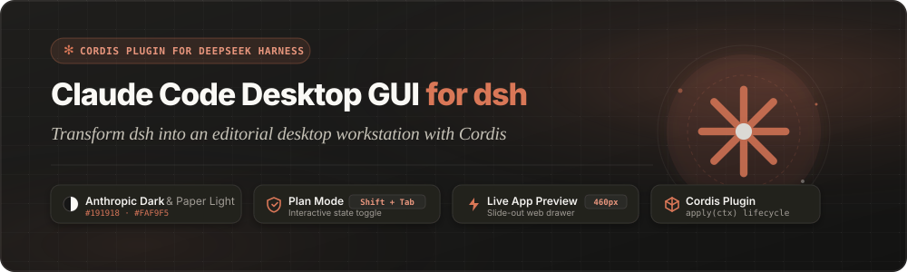
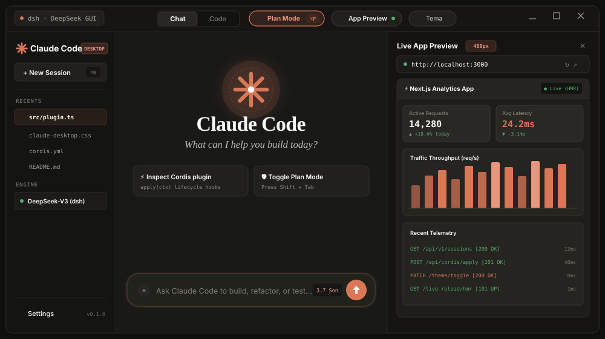
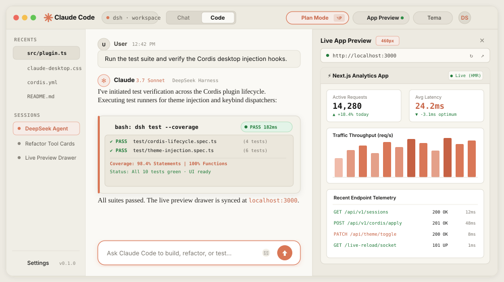
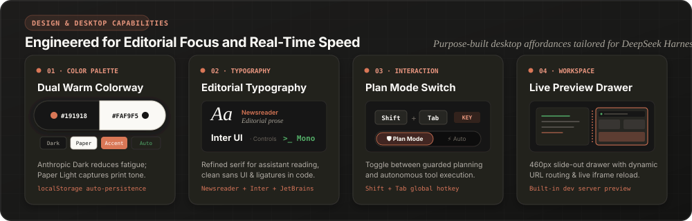
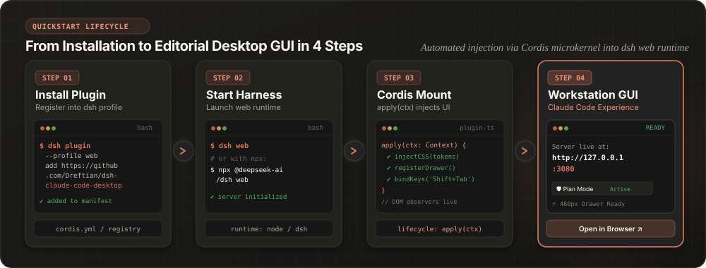

# dsh-claude-code-desktop

> Plugin visual y suite de diseño editorial para **DeepSeek Harness (`dsh`)** que transforma la interfaz web estándar en la experiencia gráfica inmersiva de **Claude Code Desktop GUI**.

[](https://www.typescriptlang.org/)
[](https://opensource.org/licenses/MIT)
[](https://github.com/deepseek-ai/dsh)

---

## 📖 Tabla de Contenido

- [🎨 Paleta de Color Oficial y Tokens de Diseño](#-paleta-de-color-oficial-y-tokens-de-diseño)
- [✨ Galería Interactiva de la Interfaz (UI Showcase)](#-galería-interactiva-de-la-interfaz-ui-showcase)
  - [Tema Oscuro: Anthropic Dark](#1-tema-oscuro-anthropic-dark-191918)
  - [Tema Claro: Paper Light](#2-tema-claro-paper-light-faf9f5)
  - [Matriz de Capacidades y Componentes](#3-matriz-de-capacidades-y-componentes)
- [🌟 Desglose Exhaustivo de Características (Feature Breakdown)](#-desglose-exhaustivo-de-características-feature-breakdown)
- [⌨️ Atajos de Teclado y Controles Rápidos](#️-atajos-de-teclado-y-controles-rápidos)
- [🚀 Guía de Instalación y Puesta en Marcha](#-guía-de-instalación-y-puesta-en-marcha)
  - [Método 1: Instalación Visual desde DeepSeek Harness Web/Desktop GUI (Recomendado)](#método-1-instalación-visual-desde-deepseek-harness-webdesktop-gui-recomendado)
  - [Método 2: CLI Oficial de DeepSeek Harness](#método-2-cli-oficial-de-deepseek-harness)
  - [Método 3: Parche Cordis Manual (`cordis.patch.yml`)](#método-3-parche-cordis-manual-cordispatchyml--claude-desktoppatchyml)
  - [Método 4: Inyección en Caliente (Hot Injection en Navegador)](#método-4-inyección-en-caliente-hot-injection-en-navegador)
- [📚 Tutorial Paso a Paso Ilustrado](#-tutorial-paso-a-paso-ilustrado)
- [📁 Estructura del Repositorio](#-estructura-del-repositorio)
- [🛠️ Compilación, Tipado y Control de Calidad](#️-compilación-tipado-y-control-de-calidad)
- [📄 Licencia](#-licencia)

---

## 🎨 Paleta de Color Oficial y Tokens de Diseño

La interfaz replica de forma idéntica la paleta cromática y la jerarquía de elevación del diseño oficial de Claude Code Desktop GUI:

| Token / Rol | Nombre de Color | Código Hex / Valor | Uso en la Interfaz |
| :--- | :--- | :--- | :--- |
| **Dark Base** | Anthropic Dark | `#191918` | Fondo principal de la aplicación (`--cc-bg-app`), canvas y contenedores primarios. |
| **Light Base** | Paper Light | `#FAF9F5` | Fondo editorial cálido (`--cc-bg-app`) imitando papel tipográfico de imprenta. |
| **Accent** | Terracotta Accent | `#D97757` | Botones de envío, acentos activos, focos interactivos y bordes destacados. |
| **Accent Hover** | Terracotta Deep | `#C66143` / `#C25E40` | Estado *hover* y *active* en botones de acción y disparadores. |
| **Dark Sidebar** | Deep Warm Noir | `#141413` | Fondo de barras laterales y paneles de navegación. |
| **Light Sidebar** | Soft Warm Cream | `#F0EEE6` | Barra lateral y paneles elevados en modo claro. |
| **Dark Surface** | Elevated Dark Surface | `#21201E` | Tarjetas de herramientas (`tool-call`), bloques de código y chips. |
| **Light Surface** | Cream Surface | `#F3F1E9` | Superficies de tarjetas elevadas en modo papel. |
| **Dark Text** | Primary Ivory | `#F4F3EE` | Tipografía principal en modo oscuro con alto contraste suave. |
| **Light Text** | Primary Charcoal | `#141413` | Tipografía principal en modo claro. |

---

## ✨ Galería Interactiva de la Interfaz (UI Showcase)

### 1. Tema Oscuro: Anthropic Dark (`#191918`)

El modo oscuro ofrece un balance cálido con contraste óptimo, protegiendo la vista durante largas jornadas de programación.



- **Barra de Navegación Nativa**: Iconografía Anthropic en terracota (`✻`), insignia de workspace activo y control segmentado **Chat | Code**.
- **Píldora Interactiva Plan Mode**: Indicador de seguridad activo en terracota translúcido (`rgba(217, 119, 87, 0.12)`).
- **Tarjetas de Herramientas**: Reemplazo de bloques de texto plano por tarjetas elevadas (`#21201E`) con bordes reactivos al cursor.
- **Drawer Lateral de Live Preview**: Panel deslizante integrado de 460px para previsualización inmediata de aplicaciones web (`http://localhost:3000`).

---

### 2. Tema Claro: Paper Light (`#FAF9F5`)

Inspirado en la impresión editorial clásica, el modo claro utiliza un fondo color papel suave y texto carbón de gran nitidez.



- **Tipografía Editorial**: Asistente formateado con fuente Newsreader Serif, otorgando una lectura fluida idéntica a una publicación de imprenta.
- **Superficies Atenuadas**: Fondos sutiles en crema (`#F3F1E9`) y bordes apergaminados (`#E2DFD6`).
- **Composer Cápsula**: Entrada de comandos flotante con esquinas redondeadas (18px) y micro-sombra refinada.

---

### 3. Matriz de Capacidades y Componentes



---

## 🌟 Desglose Exhaustivo de Características (Feature Breakdown)

### 1. 🎨 Paleta Dual Inteligente con Persistencia
- Alternancia instantánea entre **Anthropic Dark** (`#191918`) y **Paper Light** (`#FAF9F5`) mediante el botón `◐ Tema`.
- Persistencia automática de la preferencia del usuario en `localStorage('cc-desktop-theme')`.
- Adaptación dinámica de todos los componentes nativos de DeepSeek Harness.

### 2. ✍️ Sistema Tipográfico Multicapa Editorial
- **Newsreader Serif**: Tipografía serif refinada con escalado óptico para respuestas del asistente y contenido markdown.
- **Inter UI**: Tipografía sans-serif contemporánea para botones, barra superior, tabs y diálogos de control.
- **JetBrains Mono**: Tipografía monospace especializada para bloques de código, parámetros de herramientas, URL bar y chips de workspace.

### 3. 🛡️ Píldora de Permisos Interactiva (Plan Mode vs. Auto-Accept)
- Selector de modo de ejecución situado en la barra superior.
- **`🛡️ Plan Mode`**: Modo defensivo que requiere confirmación previa de cambios, resaltado en tono Terracota (`#D97757`).
- **`⚡ Auto-Accept Edits`**: Modo acelerado de aplicación directa con distintivo en verde esmeralda (`#4ADE80` / `#16A34A`).
- **Atajo Global de Teclado**: Presiona **`Shift + Tab`** en cualquier momento para alternar entre modos sin despegar las manos del teclado.

### 4. ⚡ Cajón Deslizable "Live App Preview" (Drawer de 460px)
- Panel lateral deslizable a la derecha para visualizar y probar en vivo aplicaciones web en desarrollo.
- Barra de dirección interactiva (`http://localhost:3000` por defecto) con navegación vía tecla `Enter`.
- Botón de recarga rápida (`↻`) y ajuste automático del margen de contenido del canvas para evitar solapamientos.

### 5. 🗂️ Selector Segmentado Chat | Code
- Pestañas conmutables integradas en la barra superior que permiten alternar fluidamente entre el flujo de conversación libre y la vista técnica orientada al código.

### 6. 📦 Tarjetas Gráficas de Herramientas (Tool Call Cards)
- Sustitución visual automática de bloques CLI y etiquetas `<pre>` por tarjetas gráficas estilizadas (`.cc-upgraded-tool-card`).
- Equipadas con sombra multicapa, bordes con radio de 14px y animación de borde Terracota al pasar el cursor (`:hover`).
- Soporte dinámico para contenido generado en tiempo real mediante un `MutationObserver` continuo.

### 7. 💬 Composer Flotante Ergonómico
- Caja de entrada de texto flotante con esquinas redondeadas de 18px y elevación sombreada.
- Anillo de enfoque suave en Terracota (`0 0 0 2px rgba(217, 119, 87, 0.14)`).
- Botón de envío Terracota (`#D97757`) con micro-interacción al hacer clic.

---

## ⌨️ Atajos de Teclado y Controles Rápidos

| Atajo / Acción | Ubicación | Efecto |
| :--- | :--- | :--- |
| **`Shift + Tab`** | Global (Ventana) | Alterna el modo del agente entre **`🛡️ Plan Mode`** y **`⚡ Auto-Accept Edits`**. |
| **`Enter` en URL Bar** | Drawer Lateral | Carga la dirección URL especificada dentro del iframe del visualizador en vivo. |
| **Clic en `◐ Tema`** | Barra Superior | Conmuta entre **Anthropic Dark** (`#191918`) y **Paper Light** (`#FAF9F5`). |
| **Clic en `⚡ App Preview`** | Barra Superior | Despliega u oculta el cajón de Live Preview ajustando el canvas principal. |

---

## 🚀 Guía de Instalación y Puesta en Marcha

### Método 1: Instalación Visual desde DeepSeek Harness Web/Desktop GUI (Recomendado)

El paquete está oficialmente certificado y declarado como un **Cordis Bundle** estándar en su manifiesto `package.json` (`bundle.patch: "./cordis.patch.yml"` y `dsh.bundle.patch: "./cordis.patch.yml"`). Esto permite que el instalador integrado de DeepSeek Harness descargue, active e inyecte el parche automáticamente sin tocar la consola de comandos:

1. Inicie la aplicación web o de escritorio de DeepSeek Harness.
2. Navegue a **Settings** (Configuración) en la barra de navegación o menú lateral.
3. Diríjase a la sección **Plugin Hub / Market** (Tienda de Plugins).
4. Haga clic en la opción **Install from Git** (o *Add Custom Plugin*).
5. Ingrese la URL del repositorio oficial:
   ```text
   https://github.com/Dreftian/dsh-claude-code-desktop
   ```
6. Haga clic en **Install / Enable**. DeepSeek Harness detectará el archivo [`cordis.patch.yml`](./cordis.patch.yml), vinculará el bundle al runtime Cordis y recargará la interfaz transformándola de inmediato en **Claude Code Desktop GUI**.

---

### Método 2: CLI Oficial de DeepSeek Harness

La forma estándar y recomendada para instalar y registrar el plugin mediante consola es a través del gestor de plugins CLI de DeepSeek Harness:

```bash
# Opción 1: Instalar directamente desde GitHub
dsh plugin --profile web add https://github.com/Dreftian/dsh-claude-code-desktop

# Opción 2: Usar con npx (sin instalación global de dsh)
npx @deepseek-ai/dsh plugin --profile web add https://github.com/Dreftian/dsh-claude-code-desktop

# Opción 3: Desarrollo local (apuntando al directorio del plugin)
dsh plugin --profile web add ./dsh-claude-code-desktop
```

Una vez añadido el plugin al perfil web, inicie el entorno:

```bash
dsh web
# o
npx @deepseek-ai/dsh web
```

---

### Método 3: Parche Cordis Manual (`cordis.patch.yml` / `claude-desktop.patch.yml`)

Si gestiona su entorno mediante parches declarativos de Cordis:

```bash
pnpm dsh web --patch ./claude-desktop.patch.yml
```
*(O alternativamente `./cordis.patch.yml`)*

Contenido del manifiesto [`cordis.patch.yml`](./cordis.patch.yml) / [`claude-desktop.patch.yml`](./claude-desktop.patch.yml):

```yaml
- insert:
    - id: claude-code-desktop
      name: dsh-claude-code-desktop
```

O agregándolo directamente a su archivo de configuración `cordis.yml`:

```yaml
plugins:
  dsh-claude-code-desktop: {}
```

---

### Método 4: Inyección en Caliente (Hot Injection en Navegador)

Ideal para probar de forma inmediata el diseño en una instancia en ejecución (por ejemplo, `http://127.0.0.1:3080` o `http://localhost:3080`) sin reiniciar servidores ni reconstruir paquetes.

El script [`scripts/inject-browser.js`](./scripts/inject-browser.js) es una función autoejecutable (IIFE) compatible con consolas DevTools y Userscripts.

#### Opción A: A través de DevTools Console
1. Abra la interfaz web de DeepSeek Harness en su navegador: **`http://127.0.0.1:3080`**.
2. Abra las herramientas de desarrollador presionando **`F12`** o **`Ctrl + Shift + I`** (Cmd + Option + I en macOS).
3. Seleccione la pestaña **Console (Consola)**.
4. Abra [`scripts/inject-browser.js`](./scripts/inject-browser.js), copie todo su contenido, péguelo en la consola y presione **`Enter`**.
5. La interfaz se transformará inmediatamente al diseño de Claude Code Desktop.

#### Opción B: Como Userscript (Tampermonkey / Violentmonkey)
1. Instale la extensión **Tampermonkey** o **Violentmonkey** en su navegador favorito.
2. Cree un nuevo script de usuario y pegue el código íntegro de [`scripts/inject-browser.js`](./scripts/inject-browser.js).
3. Las directivas de coincidencia ya están preconfiguradas:
   ```javascript
   // @match        http://localhost:3080/*
   // @match        http://127.0.0.1:3080/*
   // @run-at       document-idle
   ```
4. Guarde el script. Cada vez que navegue a `http://127.0.0.1:3080`, el tema se inyectará de forma automática.

#### Control Dinámico en Consola
El script expone un objeto de control en el ámbito global:

```javascript
// Desactivar el tema y volver a la interfaz original
window.dshClaudeCodeDesktop.unmount();

// Reactivar el tema y reinyectar los componentes
window.dshClaudeCodeDesktop.mount();
```

---

## 📚 Tutorial Paso a Paso Ilustrado

Siga este flujo de 4 pasos para configurar, ejecutar y disfrutar de la experiencia visual completa:



### Paso 1: Instalación del Plugin
Instale el paquete en el perfil web de DeepSeek Harness utilizando la interfaz gráfica (Settings -> Plugin Hub) o el comando CLI:
```bash
dsh plugin --profile web add https://github.com/Dreftian/dsh-claude-code-desktop
```
Este paso registra el bundle y prepara el runtime Cordis.

### Paso 2: Lanzamiento del Servidor Web
Inicie la interfaz gráfica de DeepSeek Harness:
```bash
dsh web
```
El servidor levantará el entorno local, accesible habitualmente en `http://127.0.0.1:3080`.

### Paso 3: Activación del Entorno Gráfico
Acceda a `http://127.0.0.1:3080` en su navegador. El plugin inicializará automáticamente los estilos, cargará la tipografía editorial y montará la barra superior con el drawer lateral. Si opta por inyección en caliente, aplique [`scripts/inject-browser.js`](./scripts/inject-browser.js) en la consola.

### Paso 4: Exploración de Funcionalidades
Aproveche al máximo las características integradas:
- Conmute entre modo **Dark** y **Light** mediante el botón `◐ Tema`.
- Use el atajo **`Shift + Tab`** para alternar entre `🛡️ Plan Mode` y `⚡ Auto-Accept Edits`.
- Despliegue el panel **`⚡ App Preview`** para observar aplicaciones locales en tiempo real mientras programa.

---

## 📁 Estructura del Repositorio

```
dsh-claude-code-desktop/
├── assets/                   # Diagramas vectoriales SVG de alta definición
│   ├── hero-banner.svg       # Banner principal del encabezado
│   ├── desktop-ui-dark.svg   # Mockup gráfico completo en Anthropic Dark
│   ├── desktop-ui-light.svg  # Mockup gráfico completo en Paper Light
│   ├── tutorial-flow.svg     # Diagrama de flujo de instalación y uso en 4 pasos
│   └── feature-matrix.svg    # Matriz visual de capacidades y componentes
├── cordis.patch.yml          # Manifiesto Cordis Bundle para auto-instalación en UI
├── claude-desktop.patch.yml  # Manifiesto de parche Cordis para dsh web
├── package.json              # Configuración de paquete, bundle Cordis y scripts npm
├── tsconfig.json             # Configuración del compilador TypeScript (ES2022)
├── .gitignore                # Archivos omitidos de Git
├── scripts/
│   └── inject-browser.js     # Script IIFE / Userscript para inyección en caliente
├── src/
│   ├── index.ts              # Entry point del servicio host Cordis
│   └── client/
│       ├── index.ts          # Ciclo de vida cliente, atajos de teclado y DOM
│       └── styles.ts         # Reglas CSS y variables de tokens de diseño
└── dist/                     # Salidas compiladas TypeScript (.js y .d.ts)
    ├── index.d.ts
    ├── index.js
    └── client/
        ├── index.d.ts
        ├── index.js
        ├── styles.d.ts
        └── styles.js
```

---

## 🛠️ Compilación, Tipado y Control de Calidad

El proyecto está configurado con validación estricta de TypeScript (`strict: true`) y emite tanto código JavaScript limpio como archivos de declaración de tipos (`.d.ts`).

### Comandos de Verificación

```bash
# 1. Instalar dependencias
npm install

# 2. Comprobación de tipos en tiempo estático (0 errores garantizados)
npm run typecheck

# 3. Compilación de módulos a la carpeta dist/
npm run build
```

---

## 📄 Licencia

Distribuido bajo la Licencia **MIT**. Consulte [`package.json`](./package.json) para más información.
